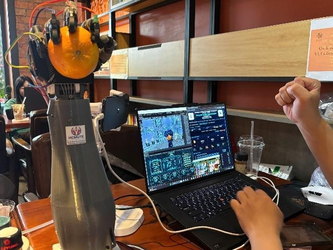
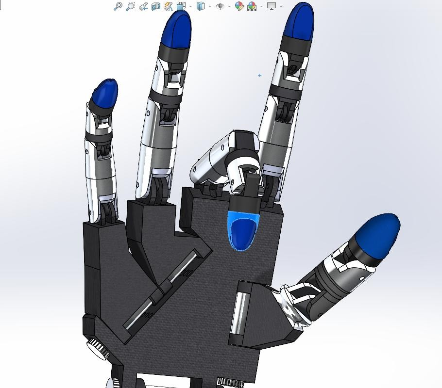
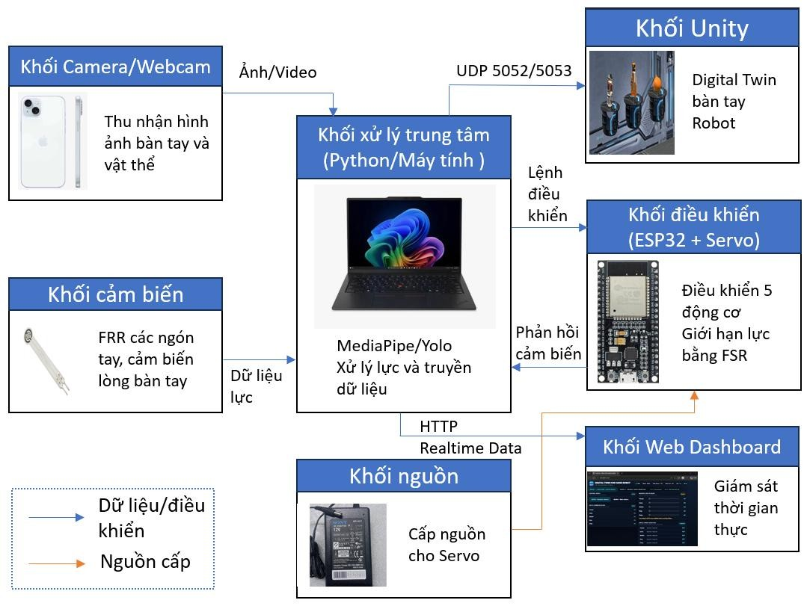
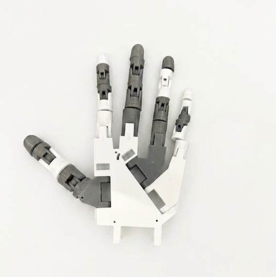
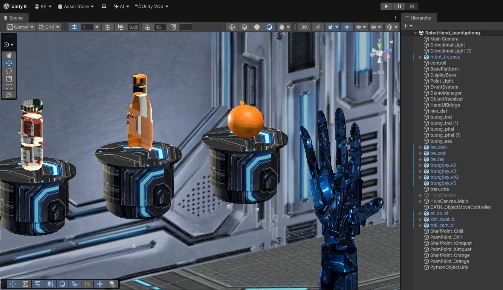
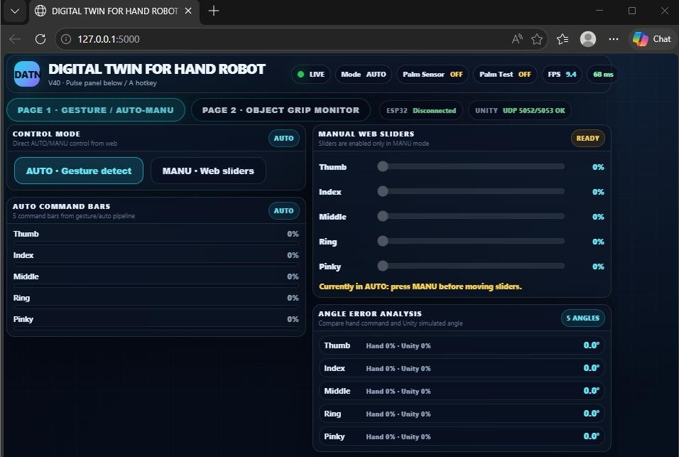

<div align="center">

# DIGITAL TWIN FOR HAND ROBOT

**Gesture-controlled robotic hand | Object recognition | Force feedback | Unity digital twin**

**Graduation Thesis · Control and Automation Engineering · 2026**  
**Ho Chi Minh City University of Technology and Education (HCMUTE)**

[**Read Thesis (PDF)**](01_Documentation/Reports/DATN_HAO_ANH.pdf) · [**Browse Source Code**](02_Source_Code) · [**Open Unity Projects**](03_Unity_Projects) · [**Mechanical Design**](04_Mechanical_Design)

 

</div>

## 01 / Project overview

**Digital Twin for Hand Robot** is a university engineering project that integrates a five-finger robotic hand with computer vision, embedded control, force-sensitive feedback, and virtual monitoring.

A camera captures the operator's hand gestures. **Python + MediaPipe** estimate finger flexion, while **YOLO** identifies selected test objects. Python sends commands to an **ESP32** via USB Serial; the ESP32 drives five servo motors through a tendon-driven mechanism and reads **RFP602 force-sensitive sensors**. Operating states and sensor values are displayed in a **Unity 3D digital twin** and a **Web Dashboard**.

The prototype demonstrates basic hand gestures and grasping of selected objects under laboratory conditions. It is an **experimental prototype**, not an industrial-grade force-controlled manipulator.

## 02 / System architecture

<div align="center">

</div>

```text
Camera / Hand gestures                Camera / Test objects
           |                                      |
     MediaPipe Hands                          YOLO
           |                                      |
           +-------------- Python ---------------+
                         |       ^
           Control commands       | Force / status feedback
                         v       |
                    USB Serial / ESP32
                         |       ^
                   PWM commands  ADC signals
                         v       |
                   5 Servo Motors + RFP Sensors
                         |
                  Physical Robotic Hand

Python  ------------------> Unity 3D Digital Twin
        ------------------> Web Dashboard
```

**Important:** The Unity model receives commanded finger-state data from Python and force/status telemetry. The present prototype **does not have joint encoders measuring actual finger angles**, so the digital twin does not provide independently verified joint-position feedback.

## 03 / Engineering implementation

| Subsystem | Implementation |
| :--- | :--- |
| Mechanical design | Five articulated fingers; SolidWorks CAD; 3D-printed components; servo-driven tendon/pulley transmission |
| Embedded control | ESP32; five servo PWM outputs; USB Serial communication with Python |
| Force sensing | RFP602 / FSR-type sensors; ADC acquisition; baseline compensation; EMA filtering; empirical calibration |
| Hand tracking | MediaPipe Hands (21 landmarks); estimation of flexion percentages for individual fingers |
| Object detection | YOLO recognition of three test-object classes; stabilized recognition and object locking |
| Grasp control | Per-finger target force, contact detection and HOLD/OVER logic to limit further closing |
| 3D simulation | Unity model receiving finger states and telemetry from Python |
| Monitoring | Web Dashboard with gesture control, grasp status, force visualization and history pages |

### Control sequence

`FREE_TRACKING → OBJECT_LOCKED → WAIT_PALM → VISION_CLOSING → FORCE_HOLD → RELEASE`

- In free tracking, the hand follows the operator's estimated finger-flexion commands.
- When an object has been recognized consistently, its class is locked and used to look up a predefined mass and calculate a target gripping force.
- The controller evaluates contact and force **for each finger**, rather than opening the entire hand from an aggregate force threshold.
- EMA filtering, deadbands, servo pulse limits and command slew limiting help reduce oscillation.

## 04 / Prototype and interfaces

<table>
<tr>
<td width="50%"><br/><b>Physical prototype</b></td>
<td width="50%"><br/><b>Unity virtual environment</b></td>
</tr>
<tr>
<td width="50%"><br/><b>Web monitoring dashboard</b></td>
<td width="50%"><br/><b>Force monitoring history</b></td>
</tr>
</table>

*Visuals are taken from the project team's graduation thesis report.*

## 05 / Experimental evaluation

The following results are **reported laboratory observations**, not certification or production acceptance tests.

| Test | Reported result | Evidence in thesis |
| :--- | :--- | :--- |
| ESP32–Python communication | Serial connection and telemetry checks marked **Passed** | Section 5.2.1, Table 5.1 |
| Five-finger servo operation | Individual open/close control tests marked **Passed** | Section 5.2.2, Table 5.2 |
| Force-sensor response | Sensors respond to applied pressure; calibration provides **relative force estimates** | Section 5.2.3, Table 5.3 |
| Gesture tracking | Basic open/close and individual-finger gestures reproduced; some jitter during rapid/occluded motion | Section 5.3, Tables 5.4–5.5 |
| Grasping selected objects | **8/8 reported grasp trials successful**: chili powder (2/2), kumquat-chili salt (3/3), orange (3/3) | Section 5.5.2, Table 5.7 |
| Force estimation error | Mean reported errors: **1.37%**, **6.43%**, **7.36%** for the three object groups, respectively | Section 5.5.4, Table 5.9 |
| Unity synchronization | Broadly follows the commanded finger poses, with larger display deviations for some thumb gestures | Section 5.6, Tables 5.10–5.12 |

**Interpretation:** The grasp results are based on a small sample of test objects and trials. The RFP measurements are approximate because of sensor nonlinearity, contact geometry and mechanical variability. The measured Python-to-Unity flexion differences are **display/data synchronization errors**, not measurements of actual robot-joint positioning accuracy.

## 06 / Repository layout

```text
Graduation-Thesis/
├── 01_Documentation/        # Thesis report and presentation
├── 02_Source_Code/          # Main Python, ESP32 and experimental code
├── 03_Unity_Projects/      # Unity projects (without generated caches)
├── 04_Mechanical_Design/   # SolidWorks parts and assemblies
├── 05_Images/              # Existing project images
├── assets/                 # README illustration gallery
├── .gitignore
└── README.md
```

The public Repository intentionally excludes the large Altium library bundle, generated Unity caches, temporary files and other nonessential archives. The thesis PDF documents the electronic circuit and PCB work; the editable Altium design is not included in this public release.

### Where to start

1. **Review the system and results:** [Thesis report (PDF)](01_Documentation/Reports/DATN_HAO_ANH.pdf), especially Chapters 3–6.
2. **Explore the implementation:** [Python/ESP32 and experiments](02_Source_Code).
3. **Inspect the 3D simulation:** [Unity project files](03_Unity_Projects); Unity-generated caches must be regenerated locally.
4. **Inspect the mechanical design:** [SolidWorks CAD](04_Mechanical_Design).

> This is a source-and-documentation portfolio. It has not been packaged as a one-click executable. Hardware, Python dependencies, camera configuration, Serial port settings and Unity version may require local setup. Refer to the thesis before attempting to operate the hardware.

## 07 / Limitations and future work

- **Mechanical:** Tendon tension, friction and printed-joint clearances affect finger motion, especially near end of travel.
- **Sensing:** RFP602 is a nonlinear, contact-dependent sensor; force readings are estimates rather than precision metrology.
- **Vision:** Hand/object tracking depends on camera positioning, illumination and occlusion.
- **Digital twin:** Unity currently mirrors control data; joint encoders or other physical position feedback are needed to validate actual kinematic synchronization.
- **Next steps:** Improve mechanics and force calibration, add joint-angle sensing, expand object datasets and improve monitoring/reproducibility.

## 08 / Thesis team and acknowledgements

| Role | Name |
| :--- | :--- |
| Student researcher | **Phạm Kiến Hào** |
| Student researcher | **Huỳnh Ngọc Hoàng Anh** |
| Academic supervisor | **Dr. Trần Vi Đô** |
| Institution | Ho Chi Minh City University of Technology and Education (HCMUTE) |
| Year | 2026 |

This is a **team graduation project**. Technical work and experimental outcomes presented here are credited to the thesis team, not to a single contributor.

**Contact:** [haopham2109@gmail.com](mailto:haopham2109@gmail.com) · [Engineering Portfolio](https://haopham2109-pixel.github.io/)
